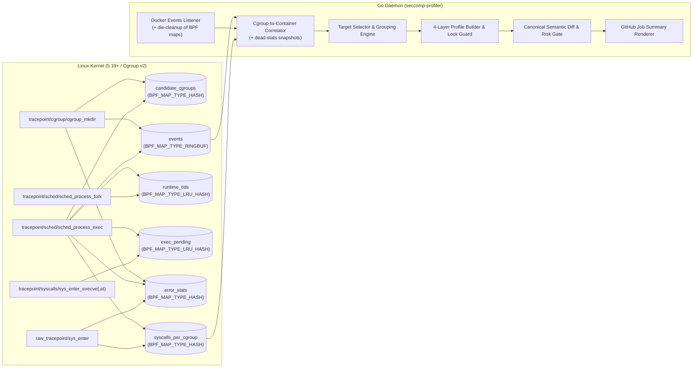

# Architecture & Security Design (`seccomp-profiler`)

This document describes the internal architecture, kernel eBPF tracing pipeline, layered profile composition, semantic diff engine, and supply-chain verification model of `seccomp-profiler`.

The demo poster/video live on the [GitHub Releases page](https://github.com/alexno10/seccomp-profiler/releases) (kept out of the repository so action runners download only source).

---

## 1. System Overview

### Kernel requirement: 5.19+

The `cgroup_mkdir` tracepoint exposes a **full 64-bit** cgroup id only from v5.19 (earlier kernels store a truncated `int`, which cannot be correlated with `bpf_get_current_cgroup_id()`). The daemon verifies `uname -r` at startup and fails fast on older kernels instead of silently producing an empty profile.

---

## 2. Kernel eBPF Tracing Architecture (`bpf/profiler.bpf.c`)

Recording container syscalls in CI requires solving three kernel-level challenges simultaneously:
1. **Zero loss on `<100ms` containers:** Ephemeral containers (e.g., `docker run --rm alpine true`) exit before userspace can receive a Docker event and inspect `/proc/<pid>/cgroup`.
2. **Zero `runc` / `crun` initialization leak — without a blind spot:** Container runtimes execute privileged setup syscalls (`mount`, `pivot_root`, `setns`, `unshare`, `keyctl`) inside the container's cgroup *before* installing the container's seccomp filter and calling `execve()` on the application entrypoint — and again during secondary `docker exec` invocations.
3. **Minimal overhead on the `sys_enter` hot path:** Host processes and build steps outside tracked containers must exit `raw_tracepoint/sys_enter` in a single hash-map lookup.

### 2.1 Hook 1: `SEC("tracepoint/cgroup/cgroup_mkdir")` & Anchor-64 Verifier Optimization
When Docker or containerd creates a container cgroup (`docker-<64hex>.scope` or `/docker/<64hex>`), `handle_cgroup_mkdir` reads the relative cgroup path from `__data_loc_path`.

To filter out host systemd units without hitting the Linux BPF verifier's 1,000,000-instruction state limit, `has_64_hex_id` uses an **Anchor-64** algorithm (`check_hex_anchor`):
- Any 64-byte contiguous hexadecimal substring inside a 255-byte NUL-terminated buffer (`path[0..254]`) is mathematically guaranteed to straddle at least one of three fixed indices: **`63`**, **`127`**, or **`191`**.
- Instead of maintaining a loop-carried run counter across 256 iterations (which multiplies verifier branch states), `check_hex_anchor` inspects those three anchor positions and counts contiguous hex bytes `[0-9a-f]` to the left and right.
- Matching cgroup IDs are inserted into `candidate_cgroups` with `STATE_PENDING_EXEC` and emitted to userspace over the `events` ring buffer.

### 2.2 Runtime Suppression Model (Hooks 2/4/5) — Hardened Against Comm Spoofing

The old design trusted `current->comm` inside `sys_enter`, which meant:
- application re-execs via `/proc/self/exe` or `fexecve` (Chromium zygotes, Go re-execs, memfd loaders) were misclassified as runtime self-execs and their syscalls were silently dropped;
- any container process could hide **all** of its syscalls (including `unshare`, `bpf`) from the profiler with `prctl(PR_SET_NAME, "runc")`, i.e. silently bypass the security gate.

The redesigned suppression uses the *pre-exec* comm as the only runtime signal:

1. **`tracepoint/syscalls/sys_enter_execve` + `sys_enter_execveat`:** if the thread's comm **before** the exec is `runc`/`crun`, the TID is recorded in `exec_pending` (LRU map).
2. **`tracepoint/sched/sched_process_fork`:** children forked by `runc`/`crun` are pre-marked in `runtime_tids` so their pre-first-exec setup syscalls (e.g. crun's `setns`/`mount`) are suppressed.
3. **`tracepoint/sched/sched_process_exec`:** an exec is treated as a runtime bootstrap re-exec **only** when the exec was initiated by the runtime (`exec_pending`) **and** lands on a self-referential binary (`/proc/self/*`, `/dev/fd/*`, `/memfd:*`) or keeps the runtime comm. In that case the TID stays suppressed. **Every other exec unmarks the TID and activates/records the cgroup** — including the container entrypoint, secondary `docker exec` workloads, and application `/proc/self/exe` re-execs.
4. **`raw_tracepoint/sys_enter`:** suppression is keyed **only** on the TID map. There is no comm check, so renaming a process to `runc` no longer hides anything. An unreadable exec filename fails open to *recording* (never to suppression).

Both suppression decisions and their absence are covered by e2e tests: the CI asserts that `unshare` inside a container is observed (gate counts it high-risk) and that a `/proc/self/exe` re-exec is recorded.

### 2.3 Hook 3: `SEC("raw_tracepoint/sys_enter")` & 32-bit Compat Isolation
- Looks up `syscalls_per_cgroup[cgroup_id]`. Non-container processes and containers still in pre-entrypoint `runc init` return `0` immediately.
- Checks `runtime_tids` only (no comm filter — see §2.2).
- **Architecture-specific 32-bit compat detection (`is_compat_syscall`):**
  - On `x86_64`, checks `thread_info.status & TS_COMPAT` (`0x0002`) and the `x32` ABI bit (`id & 0x40000000L`) rather than `thread_info.flags` bit 17 (which is `TIF_SPEC_IB` on modern x86_64 kernels).
  - On `arm64`, checks `thread_info.flags & TIF_32BIT` (`1ULL << 22`); `flags` is the first member of `struct thread_info` from 5.15 through current master.
  - Compat syscalls increment `compat_count`. **32-bit compat is unsupported by design:** profiles stay native 64-bit, and the gate fails with an explanatory message when compat syscalls were observed (a 32-bit workload would crash on the generated profile).

### 2.4 Fail-Closed Error Counters (`error_stats` map)
Any condition that silently loses visibility increments a kernel-side counter (`cgroup_map_full`, `ringbuf_drops`, `oob_syscalls`), read by the daemon at Stop. Non-zero counters fail the security gate (or warn under `fail-on: none`) — an incomplete observation must never pass as clean.

### 2.5 Bounded Maps via Userspace Die-Cleanup
When Docker reports `die`/`destroy` for a container, the daemon snapshots the cgroup's stats (`FlushCgroup`), hands them to the correlator as *dead stats*, and deletes the cgroup's entries from `syscalls_per_cgroup`/`candidate_cgroups`. The maps therefore stay bounded across huge Testcontainers suites, and the final Stop still sees the stats of long-gone containers. If a die event is missed (Docker stream down), the error counters make the shortfall visible instead of failing open.

---

## 3. Userspace Cgroup-to-Container Correlation (`internal/docker`)

The Go daemon correlates kernel events with Docker metadata from two sources:
1. **`docker events` stream (`create` / `start`):** Captures container ID, image name, container name, and all Docker/Compose/Testcontainers labels in memory at creation time (even if the container is removed milliseconds later via `--rm`). Ephemeral event attributes (`exitCode`, `execID`, `signal`, …) are filtered out of labels. The stream reconnects with backoff on failure.
2. **Inode & Ringbuf Resolution:**
   - For running containers, resolves the cgroup v2 inode (`cgroup_id`) via `stat()` on `/sys/fs/cgroup/...`.
   - For `<100ms` containers whose cgroup directory disappears before userspace `stat()` runs, extracts the 64-character hex container ID directly from the `EVENT_CGROUP_MKDIR` path captured in kernel space by the eBPF ring buffer.

By default, containers that already existed when the profiler started are **not** profiled (`include-preexisting: false`): their early syscalls were never observed, so including them would produce a silently incomplete profile. Opt-in profiling flags them `"preexisting": true` in the raw artifact. `compose-project` restricts correlation to one Compose project on shared runners.

---

## 4. Layered Profile Composition & Provenance (`internal/baseline`, `internal/profile`)

Every generated profile is built from up to four explicit layers, with per-syscall provenance stored in `.seccomp-profiler/raw/<target>.profile.v1.json`:

| Layer | Provenance Key | Included When | Purpose |
|---|---|---|---|
| **1. Observed** | `observed` | Always | Syscalls observed in `syscalls_per_cgroup` during test execution, with call counts and container coverage ratio (`containersSeen / containerCount`). |
| **2. Container Runtime Handover** | `baseline-runtime` | `minimal`, `standard` | Deterministic syscalls invoked by `runc` 1.2+ / `crun` *after* loading the seccomp filter and *before* `execve` hands control to the container entrypoint (`execve`, `readlinkat`, `openat2`, `prctl`, `capget`, `capset`, `setuid`/`setgid`, etc.). Baseline names that do not exist on the target architecture are filtered out. |
| **3. Process Lifecycle** | `baseline-lifecycle` | `standard` | Strictly `RiskLow` syscalls required for clean process shutdown (`SIGTERM`), signal handling, and memory management (`exit_group`, `rt_sigreturn`, `sigaltstack`, `close_range`, `munmap`, `nanosleep`, etc.). Enforced by unit test `TestBaselineLifecycleRiskInvariant` to never contain `Medium` or `High` risk syscalls. |
| **4. Language Runtime** | `baseline-lang:<name>` | `runtime: auto` or explicit | Startup and threading syscalls for detected runtimes (`go`, `node`, `python`, `java`). |

### Hardening Applied to Every Generated Profile
- `defaultErrnoRet: 38` (ENOSYS) so glibc/musl fall back to older syscall paths (`clone3` → `clone`, `faccessat2`, `statx`, `rseq`) instead of crashing on newer kernels.
- `clone` is only allowed with the `CLONE_NEW*` namespace flags masked out (Docker-default-style arg rule); `clone3` answers ENOSYS. An unconditional clone allow is equivalent to `unshare` and is treated as high-risk drift.
- Target names (derived from labels/images) are validated against `^[A-Za-z0-9._-]{1,100}$`; traversal attempts are skipped and reported. Image-ID-only references fall back to the container ID instead of collapsing into a `sha256` target.

### Hand-Edited Profile Protection (`.seccomp-profiler/lock.json`)
`WriteTargetFiles` records the SHA-256 digest of every generated `<target>.json` in `.seccomp-profiler/lock.json`. If `<target>.json` already exists on disk and either `lock.json` is absent or the file's SHA-256 differs from `lock.json`, `seccomp-profiler` treats `<target>.json` as human-maintained, leaves it untouched, and writes the newly generated profile to `<target>.suggested.json`.

### PR-Safe Baseline Reads (`baseline-ref`)
On pull request events the committed reference profile **and** `accepted.yml` are read from a pristine checkout of the PR **base ref** (fetched via `git fetch` + `git worktree` by the action). A PR therefore cannot widen its own baseline or self-approve syscalls. Files that the PR itself modified are reported as drift warnings in the Job Summary.

---

## 5. Canonical Semantic Diff, Risk Tiers & Security Gate (`internal/diff`)

During Pull Requests, `diff.Compare` normalizes both the committed reference profile and the newly generated profile (ignoring syscall ordering) and classifies newly added syscalls into three risk tiers:

- **`High` (Container Escape / Kernel Modification):** `ptrace`, `process_vm_readv/writev`, `process_madvise`, `pidfd_getfd`, `mount`, `umount2`, the new mount API (`fsopen`, `fsmount`, `fsconfig`, `fspick`, `move_mount`, `open_tree`, `mount_setattr`), `pivot_root`, `unshare`, `setns`, `bpf`, `perf_event_open`, `userfaultfd`, `io_uring_*`, `keyctl`, `add_key`, `request_key`, `init_module`, `finit_module`, `delete_module`, `kexec_load/file_load`, `open_by_handle_at`, `name_to_handle_at`, `kcmp`, `ioperm`, `iopl`, `swapon/swapoff`, `reboot`, `acct`, `quotactl`, `syslog`, `clock_settime`, `settimeofday`, `adjtimex`, `sethostname`, `setdomainname`, `personality`, `fanotify_init`, `lookup_dcookie`, `move_pages`, `migrate_pages`, `uselib`, `vhangup`, and unconditional `clone`/`clone3`.
- **`Medium` (Network / Process Execution / Privilege Change):** `socket`, `connect`, `bind`, `listen`, `accept/accept4`, `execve`, `execveat`, arg-constrained `clone`/`clone3`, `fork`, `vfork`, `chown*`, `chmod*`, `setuid/gid` family, `capset`, `chroot`, `mknod`, `ioctl`, etc.
- **`Low`:** Standard in-namespace I/O, memory, time, and synchronization syscalls.

**Constraint escalation** is a separate high-risk drift class: a syscall that existed only under argument constraints in the committed profile and now appears as an unconditional allow fails the gate (approvable via `accepted.yml` like any other high-risk syscall). Loosened/tightened arg constraints on conditional rules are reported informationally.

Removed syscalls are reported as **informational only** and are preserved in the merged output profile (`MergeCommittedIntoOCI`) so partial test runs never break existing production capabilities; `prune: true` opts into keeping them removed. Arg-constrained rules from both profiles always survive the merge, so a conditional allow can never silently widen.

Unapproved syscalls that violate `fail-on` (`high-risk` or `any-new`) fail the CI gate unless explicitly approved with a non-expired entry in `accepted.yml`. `on-change: update-pr` writes the generated profiles to the committed-profile location for the PR author to commit.

---

## 6. Supply-Chain Security & Privilege Isolation (`action/`, `.github/workflows/release.yml`)

1. **Deterministic & Self-Contained Binaries:**
   - Release binaries (`seccomp-profiler-linux-amd64` and `seccomp-profiler-linux-arm64`) embed their architecture-specific compiled `profiler.bpf.o` via `//go:embed` (`-tags embed_bpf`) and are built with `-ffile-prefix-map`, `-trimpath`, `-buildvcs=false`, and `-ldflags="-s -w -buildid= -X main.version=<tag>"`. The release builds use pinned `clang-18`; unit tests run as a required job before any release artifact is produced.
2. **Commit-Locked Version & Binary Digests:**
   - Every Action commit pins `PINNED_RELEASE_REPO`, `PINNED_RELEASE_VERSION`, and `PINNED_BINARY_SHA256` (`amd64` and `arm64`) in `action/lib.js`. Pinning `uses: alexno10/seccomp-profiler@<commit-sha>` guarantees immutable binary execution. Releases are cut only from tag pushes; published release assets are never overwritten.
3. **Verified Binary Cache:**
   - Binaries cache under `/opt/seccomp-profiler/<version>/`. A cached binary is re-verified against the commit-locked SHA-256 on every run and re-downloaded on mismatch. `SECCOMP_PROFILER_BIN` provides an explicit trusted override (used by this repo's CI to exercise freshly built binaries).
4. **Pinned Cosign Bootstrap:**
   - `ensureCosign` downloads `cosign` `v2.4.1` and verifies its SHA-256 against the hardcoded `COSIGN_SHA256` table before marking it executable.
5. **Anchored Keyless OIDC Verification of `checksums.txt` and Binaries:**
   - Both `checksums.txt` (`checksums.txt.sig`, `checksums.txt.pem`) and each release binary (`seccomp-profiler-linux-<arch>.sig`, `.pem`) are signed in GitHub Actions via Sigstore Fulcio/Rekor and verified with:
     - `--certificate-identity-regexp '^https://github\.com/alexno10/seccomp-profiler/\.github/workflows/release\.yml@refs/tags/v[0-9]+\.[0-9]+\.[0-9]+$'`
     - `--certificate-oidc-issuer 'https://token.actions.githubusercontent.com'`
6. **`sudo` Daemon Environment Isolation:**
   - `buildDaemonEnv` passes only a minimal allowlist (`PATH`, `HOME`, `DOCKER_HOST`, etc.) to the background `sudo` daemon, stripping `RUNNER_TRACKING_ID` and all GitHub Actions runtime/OIDC tokens and secrets. The allowlist is applied with `sudo --preserve-env=...` so `env_reset`/`secure_path` cannot silently drop `DOCKER_HOST` (DinD, rootless Docker, docker context).
7. **Output Ownership:** generated profiles/raw/lock files are chowned back to `SUDO_UID:SUDO_GID` so later workspace steps do not hit permission errors.

## 7. Known Limitations

- 32-bit compat workloads are detected and failed, not profiled.
- `accepted.yml` is parsed by a deliberately minimal YAML subset (flat `accepted:` list). Nested anchors are rejected as unknown keys rather than silently ignored.
- Runtime auto-detection for Go recognizes the `go` tool and `golang`-derived image names; statically compiled Go binaries are not recognized by filename.
- The `tcp://` control endpoint has no authentication; it is intended for local testing. The default is a root-only unix socket.
- Media/demo assets live in GitHub Releases, not the repository.
