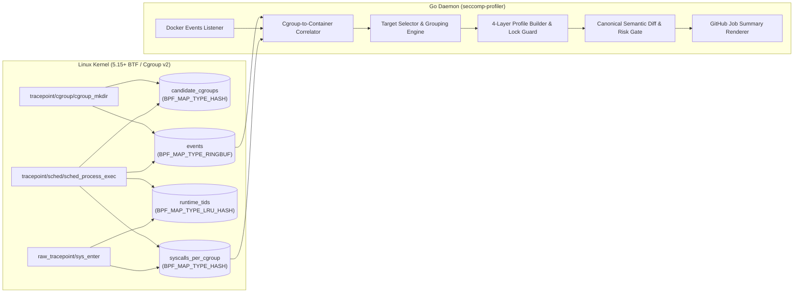

# Architecture & Security Design (`seccomp-profiler`)

This document describes the internal architecture, kernel eBPF tracing pipeline, layered profile composition, semantic diff engine, and supply-chain verification model of `seccomp-profiler`.

---

## 1. System Overview

---

## 2. Kernel eBPF Tracing Architecture (`bpf/profiler.bpf.c`)

Recording container syscalls in CI requires solving three kernel-level challenges simultaneously:
1. **Zero loss on `<100ms` containers:** Ephemeral containers (e.g., `docker run --rm alpine true`) exit before userspace can receive a Docker event and inspect `/proc/<pid>/cgroup`.
2. **Zero `runc` / `crun` initialization leak:** Container runtimes execute privileged setup syscalls (`mount`, `pivot_root`, `setns`, `unshare`, `keyctl`) inside the container's cgroup *before* installing the container's seccomp filter and calling `execve()` on the application entrypoint — and again during secondary `docker exec` invocations.
3. **Minimal overhead on the `sys_enter` hot path:** Host processes and build steps outside tracked containers must exit `raw_tracepoint/sys_enter` in a single hash-map lookup.

### 2.1 Hook 1: `SEC("tracepoint/cgroup/cgroup_mkdir")` & Anchor-64 Verifier Optimization
When Docker or containerd creates a container cgroup (`docker-<64hex>.scope` or `/docker/<64hex>`), `handle_cgroup_mkdir` reads the relative cgroup path from `__data_loc_path`.

To filter out host systemd units without hitting the Linux BPF verifier's 1,000,000-instruction state limit, `has_64_hex_id` uses an **Anchor-64** algorithm (`check_hex_anchor`):
- Any 64-byte contiguous hexadecimal substring inside a 255-byte NUL-terminated buffer (`path[0..254]`) is mathematically guaranteed to straddle at least one of three fixed indices: **`63`**, **`127`**, or **`191`**.
- Instead of maintaining a loop-carried run counter across 256 iterations (which multiplies verifier branch states), `check_hex_anchor` inspects those three anchor positions and counts contiguous hex bytes `[0-9a-f]` to the left and right.
- Matching cgroup IDs are inserted into `candidate_cgroups` with `STATE_PENDING_EXEC` and emitted to userspace over the `events` ring buffer.

### 2.2 Hook 2: `SEC("tracepoint/sched/sched_process_exec")` & Runtime Suppression
`handle_sched_process_exec` fires inside the kernel immediately after `begin_new_exec()` updates `current->comm`:
- If `is_runtime_self_exec(comm, filename)` detects `runc`, `crun`, `/proc/self/*` (such as `runc`'s cloned memfd re-exec), or `/dev/fd/*`, the thread's TID is recorded in `runtime_tids` (`BPF_MAP_TYPE_LRU_HASH`) and the event is ignored.
- On the first non-runtime `execve` inside a candidate cgroup (the container's real entrypoint), the TID is removed from `runtime_tids`, `syscalls_per_cgroup[cgroup_id]` is initialized from a zeroed `.rodata` template (`BPF_NOEXIST`), and `EVENT_EXEC` is sent to userspace so the daemon can auto-detect language runtimes (`go`, `node`, `python`, `java`).

### 2.3 Hook 3: `SEC("raw_tracepoint/sys_enter")` & 32-bit Compat Isolation
- Looks up `syscalls_per_cgroup[cgroup_id]`. Non-container processes and containers still in pre-entrypoint `runc init` return `0` immediately.
- Checks `runtime_tids` and `is_runtime_comm(comm)` so secondary `docker exec` setup syscalls executed by `runc` inside an already-active container cgroup are never recorded.
- **Architecture-specific 32-bit compat detection (`is_compat_syscall`):**
  - On `x86_64`, checks `thread_info.status & TS_COMPAT` (`0x0002`) and the `x32` ABI bit (`id & 0x40000000L`) rather than `thread_info.flags` bit 17 (which is `TIF_SPEC_IB` on modern x86_64 kernels).
  - On `arm64`, checks `thread_info.flags & TIF_32BIT` (`1ULL << 22`).
  - Compat syscalls increment `compat_count` and are excluded from the 64-bit syscall ID array so 32-bit syscall numbers never alias 64-bit syscall numbers, and generated profiles emit only native 64-bit architectures (`SCMP_ARCH_X86_64` or `SCMP_ARCH_AARCH64`) unless compat calls were actually observed.

---

## 3. Userspace Cgroup-to-Container Correlation (`internal/docker`)

The Go daemon correlates kernel events with Docker metadata from two sources:
1. **`docker events` stream (`create` / `start`):** Captures container ID, image name, container name, and all Docker/Compose/Testcontainers labels in memory at creation time (even if the container is removed milliseconds later via `--rm`).
2. **Inode & Ringbuf Resolution:**
   - For running containers, resolves the cgroup v2 inode (`cgroup_id`) via `stat()` on `/sys/fs/cgroup/...`.
   - For `<100ms` containers whose cgroup directory disappears before userspace `stat()` runs, extracts the 64-character hex container ID directly from the `EVENT_CGROUP_MKDIR` path captured in kernel space by the eBPF ring buffer.

---

## 4. Layered Profile Composition & Provenance (`internal/baseline`, `internal/profile`)

Every generated profile is built from up to four explicit layers, with per-syscall provenance stored in `.seccomp-profiler/raw/<target>.profile.v1.json`:

| Layer | Provenance Key | Included When | Purpose |
|---|---|---|---|
| **1. Observed** | `observed` | Always | Syscalls observed in `syscalls_per_cgroup` during test execution, with call counts and container coverage ratio (`containersSeen / containerCount`). |
| **2. Container Runtime Handover** | `baseline-runtime` | `minimal`, `standard` | Deterministic syscalls invoked by `runc` 1.2+ / `crun` *after* loading the seccomp filter and *before* `execve` hands control to the container entrypoint (`execve`, `readlinkat`, `openat2`, `prctl`, `capget`, `capset`, `setuid`/`setgid`, etc.). |
| **3. Process Lifecycle** | `baseline-lifecycle` | `standard` | Strictly `RiskLow` syscalls required for clean process shutdown (`SIGTERM`), signal handling, and memory management (`exit_group`, `rt_sigreturn`, `sigaltstack`, `close_range`, `munmap`, `nanosleep`, etc.). Enforced by unit test `TestBaselineLifecycleRiskInvariant` to never contain `Medium` or `High` risk syscalls. |
| **4. Language Runtime** | `baseline-lang:<name>` | `runtime: auto` or explicit | Startup and threading syscalls for detected runtimes (`go`, `node`, `python`, `java`). |

### Hand-Edited Profile Protection (`.seccomp-profiler/lock.json`)
`WriteTargetFiles` records the SHA-256 digest of every generated `<target>.json` in `.seccomp-profiler/lock.json`. If `<target>.json` already exists on disk and either `lock.json` is absent or the file's SHA-256 differs from `lock.json`, `seccomp-profiler` treats `<target>.json` as human-maintained, leaves it untouched, and writes the newly generated profile to `<target>.suggested.json`.

---

## 5. Canonical Semantic Diff, Risk Tiers & Security Gate (`internal/diff`)

During Pull Requests, `diff.Compare` normalizes both the committed reference profile and the newly generated profile (ignoring syscall ordering) and classifies newly added syscalls into three risk tiers:

- **`High` (Container Escape / Kernel Modification):** `ptrace`, `process_vm_readv`, `process_vm_writev`, `mount`, `umount2`, `pivot_root`, `unshare`, `setns`, `bpf`, `perf_event_open`, `userfaultfd`, `keyctl`, `add_key`, `request_key`, `init_module`, `finit_module`, `delete_module`, `kexec_load`, `kexec_file_load`, `open_by_handle_at`, `name_to_handle_at`, `ioperm`, `iopl`, `swapon`, `swapoff`, `reboot`, `acct`, `quotactl`, `syslog`.
- **`Medium` (Network / Process Execution / Privilege Change):** `socket`, `connect`, `bind`, `listen`, `accept`, `accept4`, `execve`, `execveat`, `clone`, `clone3`, `fork`, `vfork`, `chown`, `chmod`, `setuid`, `setgid`, `capset`, `chroot`, `mknod`, `ioctl`, etc.
- **`Low`:** Standard in-namespace I/O, memory, time, and synchronization syscalls.

Removed syscalls are reported as **informational only** and are preserved in the merged output profile (`MergeCommittedIntoOCI`) so partial test runs never break existing production capabilities.

Unapproved syscalls that violate `fail-on` (`high-risk` or `any-new`) fail the CI gate unless explicitly approved with a non-expired entry in `.seccomp-profiler/accepted.yml`.

---

## 6. Supply-Chain Security & Privilege Isolation (`action/main.js`, `.github/workflows/release.yml`)

1. **Deterministic & Self-Contained Binaries:**
   - Release binaries (`seccomp-profiler-linux-amd64` and `seccomp-profiler-linux-arm64`) embed their architecture-specific compiled `profiler.bpf.o` via `//go:embed` (`-tags embed_bpf`) and are built with `-ffile-prefix-map`, `-trimpath`, `-buildvcs=false`, and `-ldflags="-s -w -buildid="`.
2. **Commit-Locked Version & Binary Digests:**
   - Every Action commit pins `PINNED_RELEASE_REPO`, `PINNED_RELEASE_VERSION`, and `PINNED_BINARY_SHA256` (`amd64` and `arm64`) directly in `action/main.js`. Pinning `uses: alexno10/seccomp-profiler@<commit-sha>` guarantees immutable binary execution.
3. **Pinned Cosign Bootstrap:**
   - `ensureCosign` downloads `cosign` `v2.4.1` and verifies its SHA-256 against the hardcoded `COSIGN_SHA256` table before marking it executable.
4. **Anchored Keyless OIDC Verification of `checksums.txt` and Binaries:**
   - Both `checksums.txt` (`checksums.txt.sig`, `checksums.txt.pem`) and each release binary (`seccomp-profiler-linux-<arch>.sig`, `.pem`) are signed in GitHub Actions via Sigstore Fulcio/Rekor and verified with:
     - `--certificate-identity-regexp '^https://github\.com/alexno10/seccomp-profiler/\.github/workflows/release\.yml@refs/tags/v[0-9]+\.[0-9]+\.[0-9]+$'`
     - `--certificate-oidc-issuer 'https://token.actions.githubusercontent.com'`
5. **`sudo` Daemon Environment Isolation:**
   - `buildDaemonEnv` passes only a minimal allowlist (`PATH`, `HOME`, `DOCKER_HOST`, etc.) to the background `sudo` daemon, stripping `RUNNER_TRACKING_ID` and all GitHub Actions runtime/OIDC tokens and secrets.
